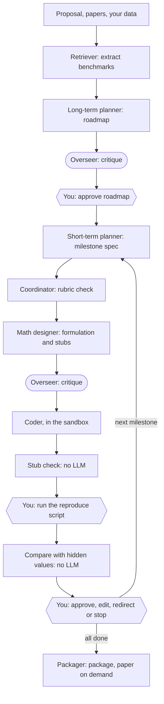

# r2r: research-to-results

[](https://github.com/arvindersingh39/research-to-results/actions/workflows/ci.yml)


**Turn a research proposal into a tested Python package, and a LaTeX paper on request, with a
team of LLM agents. Plain code and a human keep control of the decisions.**

You write a proposal in Markdown and add any papers or reference data. r2r plans the work as
milestones, implements each one in an isolated sandbox, and stops at gates for your approval.
When a proposal or your data contains numbers the work should reproduce, the coding agent never
sees them: you run the code, and plain Python compares the results with the hidden values.

## Quick start

You need [uv](https://docs.astral.sh/uv/) (it installs Python 3.12 for you) and, for real runs,
[Docker](https://www.docker.com/).

```bash
git clone https://github.com/arvindersingh39/research-to-results.git
cd research-to-results
./scripts/setup.sh
```

The script installs the locked dependencies, creates a private `.env`, and runs the offline
tests. Those tests use a fake LLM, so they need no API keys and cost nothing.

To run the real pipeline:

```bash
# 1. Add ANTHROPIC_API_KEY and OPENROUTER_API_KEY to .env
# 2. Build the sandbox (Docker must be running; about 2 GB)
uv run r2r sandbox build
# 3. Check your keys and models (under $0.01)
uv run python scripts/check_models.py
# 4. Run the example proposal, which spends real API credit
uv run r2r run --proposal examples/pilot_mc_pricer
```

By default a run stops and asks you before going over $3 per milestone or $20 in total. You can
change these limits and the models in `config/`.

Setup has been tested on macOS (Apple Silicon) and, for the offline tests, on Linux through CI.

## How it works



The [full network](docs/images/network_current.png) also shows the retry paths. See
[docs/architecture.md](docs/architecture.md) for details.

## What makes it different

- **Your proposal drives the work.** r2r doesn't invent research ideas. It carries out the
  question and acceptance criteria you give it.
- **Code makes the control decisions.** Stopping, routing, retries and budget checks are plain
  Python, never an LLM's judgement.
- **The coder can't see the answers.** Reference values stay outside its workspace. It only sees
  their names and descriptions.
- **Results are compared by code.** Tolerances come from your data. A value with no tolerance is
  reported as unchecked, never as passed, and results that all match exactly are flagged as copied.
- **Models check each other.** Different vendors plan, critique and code, so one model's blind
  spot is less likely to pass unchallenged.
- **Agents exchange contracts, not chat.** Every message is a size-limited Pydantic model, and
  large data lives in a blob store.

## Features

| Area | What you get |
|---|---|
| **Pipeline** | PDF ingestion, local embeddings, roadmap replanning, milestone splitting, `r2r extend` to continue a finished run |
| **Human control** | Gates in the terminal or on Telegram, redirect or stop at any gate, optional rule-based autopilot |
| **Cost control** | Run and milestone caps checked before each call, a cost ledger (`r2r costs`), prompt caching, optional Langfuse tracing |
| **Sandbox** | Docker with no network, no environment variables, no capabilities, a read-only root, a non-root user, and CPU, memory and process limits |
| **Secrets** | Keys stay in `.env`, are redacted from logs, and never enter the sandbox |
| **Untrusted input** | Proposal and paper text is wrapped as data, and instructions inside it are not followed |
| **Providers** | Any model LiteLLM supports. Each role is one line in `config/models.yaml`, with a fallback ladder for structured output |
| **Output** | An installable wheel checked in a clean offline sandbox, and an arXiv-style LaTeX paper on request |

## Commands

| Command | What it does |
|---|---|
| `uv run r2r run --proposal <folder>` | Start a run (`--autopilot`, `--channel`, `--export-dir`) |
| `uv run r2r resume <run>` | Continue from the last checkpoint or a pending gate |
| `uv run r2r status <run>` | Show the current milestone, gate and spend |
| `uv run r2r show <run> <contract>` | Show a contract from the run's state |
| `uv run r2r costs <run>` | Show spend by role, model and milestone |
| `uv run r2r extend <run> --proposal <folder>` | Add new work to a finished run |
| `uv run r2r publish <run> --mode paper` | Build the paper or package |
| `uv run r2r sandbox build` / `sandbox check` | Build the sandbox image, or test its limits |

## Results so far

| Run | Task | Cost | What it showed |
|---|---|---|---|
| `pilot-1` | Monte Carlo option pricer | $1.78 | Found that design tests could be wrong, which led to better checks |
| `pilot-2` | Ising model study, 8-page paper | $4.84 | The overseer flagged a wrong reference value in the roadmap (0.9862, where the formula gives 0.9569) |
| `study-3` | Larger simulation study | $41.66 | Ledger analysis found 39% waste at one point in the run, and the fixes changed the design |

These costs include failed attempts. The pilots ran on an earlier version of the pipeline, before
the [redesign](docs/design-history.md) to the current network.

## Limitations

- **Without benchmarks there's no automatic correctness check.** Such a milestone only gets the
  stub check, the overseer's review and yours. A passing stub check means the code runs and
  matches its interface, not that the maths is right.
- **You review and run results yourself.** The benchmark gate is deliberately manual.
- **Runs resume at node boundaries.** Recovery from a process killed in the middle of a node isn't
  hardened yet.
- **WhatsApp gates are built and tested against a fake API only.** Use the terminal or Telegram.
- **Live runs depend on provider model IDs and prices,** which change. Check them with
  `scripts/check_models.py`.

## Roadmap

- [ ] Harden crash recovery so a killed step re-runs cleanly
- [ ] Add a full-screen terminal app and an `r2r doctor` command
- [ ] Run the WhatsApp gates live

## Development

```bash
uv run pytest -q                          # offline tests, fake LLM, no cost
uv run pytest -q -m docker                # sandbox tests, Docker must be running
R2R_LIVE=1 uv run pytest tests/live -q    # live tests: these spend real money
uv run ruff check
```

Further reading:

- [Architecture](docs/architecture.md)
- [Design history](docs/design-history.md), from the first sketch to the current network
- [Design decisions](docs/DECISIONS.md), the numbered IDs you'll see in code comments
- [Original build plan](docs/PLAN.md)

## How it was built

I designed the system, made the decisions in the log and ran the studies. The code was written
with [Claude Code](https://claude.com/claude-code), working phase by phase under the rules in
[CLAUDE.md](CLAUDE.md), which is why commits carry a co-author line.

## License

[MIT](LICENSE) © 2026 Arvinder Singh
