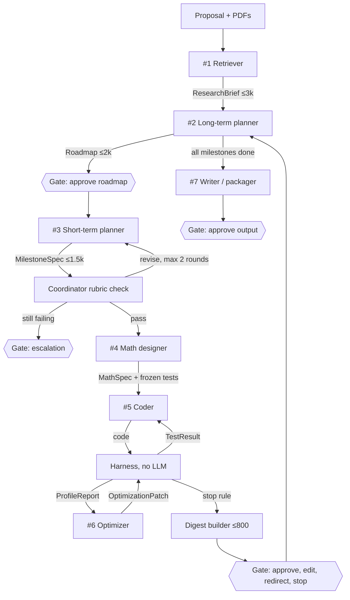

# r2r — implementation plan for Claude Code

> Read `docs/PROGRESS.md` first, then only the section for the current phase.
> Phases run in order. ⛔ marks a checkpoint: stop, report and wait for the owner (§9).
> Every default in this plan stands until the owner overrides it in the PROGRESS.md Decisions log.

## 1. Goal

Build `r2r`, a Python framework that takes a research proposal (a Markdown file plus
optional PDFs) and drives a team of LLM agents to publish-ready output: a compiling
LaTeX paper, an installable and tested Python package, or both. A human approves the
first roadmap, reviews every milestone's results, and signs off on the final output.

The project is complete when the end-to-end acceptance test in §10 passes.

## 2. Architecture



The roadmap gate `G0` runs on the first cycle, and afterwards only when a roadmap update
adds, removes or reorders milestones or changes the goal.

| Role | Default model | Reads | Writes |
|---|---|---|---|
| #1 Retriever | Gemini 3.8 Flash | proposal, extracted paper text | `PaperCard`s, `ResearchBrief` |
| #2 Long-term planner | Claude Opus 5.5 | brief, roadmap, latest digest, human note | `Roadmap`, rewritten each cycle |
| #3 Short-term planner | Claude Sonnet 5 | current milestone, context pack | `MilestoneSpec` |
| Coordinator | Gemini 3.1 Pro | spec, milestone, rubric | `CoordinatorVerdict` |
| #4 Math designer | Gemini 3.1 Pro | spec, context pack | `MathSpec` plus frozen tests, SymPy checks, stubs, bench |
| #5 Coder | Claude Sonnet 5, Opus 5.5 when stuck | `MathSpec`, spec, `TestResult` | code, through tools |
| #6 Optimizer | Gemini 3.8 Flash | `ProfileReport`, hotspot source | `OptimizationPatch` |
| Digest | template; cheap model only for the deviations note | test, bench and ledger data | `ResultDigest` |
| #7 Writer / packager | Claude Opus 5.5 | brief, PaperCards, digests, figures, `refs.bib` | `PublicationBundle` |
| Harness | no LLM | workspace | `TestResult`, `ProfileReport`, `OptimizationOutcome` |

These are defaults only: every model is a string in `config/models.yaml`, so changing
providers never touches code. Model families are split on purpose (coordinator differs
from the planners; test author #4 differs from coder #5) so one model's blind spot
cannot pass two stages.

## 3. Tech stack

| Concern | Choice | Notes |
|---|---|---|
| Language and packaging | Python 3.12, `uv` | lockfile committed |
| Orchestration | LangGraph with SQLite checkpointer | interrupts for human gates; resumable runs |
| LLM access | LiteLLM behind `r2r.llm.gateway` | one interface for Claude, Gemini, OpenRouter |
| Contracts | Pydantic v2 | size caps enforced at validation |
| Vector store | Chroma (embedded) | one collection per run |
| PDF text | PyMuPDF | Docling can come later for equations and tables |
| Sandbox | Docker through the `docker` SDK | network off, resource limits; E2B backend optional |
| Checks on generated code | pytest, pytest-timeout, Hypothesis, SymPy, radon, cProfile | all run inside the sandbox |
| CLI | Typer and Rich | `r2r run`, `resume`, `status`, `show`, `costs`, `ingest`, `bot` |
| Human gates | Terminal, plus WhatsApp through Meta's official Cloud API | `httpx` to send; FastAPI and uvicorn for the webhook receiver; a tunnel with a stable hostname, e.g. cloudflared or ngrok (D11). No unofficial WhatsApp Web libraries. |
| Retries | tenacity | backoff on 429 and 5xx |
| Cost tracking | SQLite ledger (required); Langfuse through a LiteLLM callback (optional) | |
| Publishing | Jinja2 and tectonic, inside the sandbox | LaTeX bundle pre-cached in the image |
| Dev tools | pytest, Hypothesis, ruff | |

Anything not listed here needs owner approval (see CLAUDE.md).

## 4. Repository layout

```
r2r/
├── CLAUDE.md
├── README.md
├── pyproject.toml
├── .env.example
├── config/
│   ├── models.yaml        # role → model and call settings
│   ├── budgets.yaml       # spend caps, loop limits, gates, contract caps
│   └── rubric.yaml        # coordinator criteria
├── prompts/               # one system prompt per role; stable content first (cacheable)
├── docs/                  # PLAN.md, PROGRESS.md, architecture.md
├── sandbox/Dockerfile
├── scripts/check_models.py
├── src/r2r/
│   ├── settings.py
│   ├── log.py             # structured logging with secret redaction
│   ├── contracts/         # every Pydantic contract (§6)
│   ├── llm/               # gateway.py, tools.py, fake.py, tokens.py, batch.py
│   ├── store/             # blobs.py, ledger.py, runs.py
│   ├── ingest/            # pdf.py, chunk.py, citations.py
│   ├── retrieval/         # vectors.py, context_pack.py
│   ├── agents/            # retriever, long_planner, short_planner, coordinator,
│   │                      # math_designer, coder, optimizer, writer
│   ├── harness/           # sandbox, workspace, frozen, tests, checks, bench,
│   │                      # profile, gitops, stoprule
│   ├── graph/             # state.py, nodes.py, build.py, gates.py
│   ├── digest/            # builder.py
│   ├── publish/           # latex.py, package.py, templates/
│   └── cli.py
├── tests/                 # tests of the framework itself
│   ├── unit/
│   ├── graph/
│   ├── docker/
│   ├── live/              # only with R2R_LIVE=1, after owner approval
│   └── fixtures/          # canned contracts, slow_project/, generated PDFs
├── examples/
│   └── pilot_mc_pricer/   # proposal.md and optional papers/ for §10
└── runs/                  # git-ignored; one directory per run
    └── <run_id>/
        ├── workspace/     # git repo the agents build in
        │   ├── src/
        │   ├── bench/
        │   ├── figures/
        │   ├── tests/frozen/   # written by #4 only; read-only to #5 and #6
        │   └── checks/         # SymPy checks; same protection
        ├── blobs/
        ├── vectors/
        ├── checkpoints.sqlite
        └── ledger.sqlite
```

There are two test trees and they never mix: `tests/` checks the framework itself, while
`runs/<id>/workspace/tests/frozen/` holds the tests the agents write for the research code.

## 5. Configuration

### `config/models.yaml`

```yaml
# Verify every ID in Phase 0 with scripts/check_models.py.
# Gemini IDs especially: 3.1 Pro may carry a "-preview" suffix.
roles:
  retriever:     {model: gemini/gemini-3.8-flash,   max_tokens: 4000}
  long_planner:  {model: anthropic/claude-opus-5-5, max_tokens: 3000, thinking_budget: 4000}
  short_planner: {model: anthropic/claude-sonnet-5, max_tokens: 2500}
  coordinator:   {model: gemini/gemini-3.1-pro,     max_tokens: 800}
  math_designer: {model: gemini/gemini-3.1-pro,     max_tokens: 8000}
  coder:         {model: anthropic/claude-sonnet-5, escalate_to: anthropic/claude-opus-5-5,
                  max_tokens: 4000}
  optimizer:     {model: gemini/gemini-3.8-flash,   max_tokens: 3000}
  digest:        {model: gemini/gemini-3.8-flash,   max_tokens: 300}   # deviations note only
  writer:        {model: anthropic/claude-opus-5-5, max_tokens: 6000}
embeddings:      {model: null}    # chosen at Phase 0: Gemini embeddings or a local model
cache_prefix: true                # prompt caching on system prompt + output schema
price_overrides: {}               # USD per million tokens, if LiteLLM's price map is stale
                                  # (Gemini Flash introductory pricing ends 2026-12-31)
```

### `config/budgets.yaml`

```yaml
usd_cap_run: 20.0
usd_cap_milestone: 3.0
coordinator_max_revise_rounds: 2
coder_max_turns: 25
coder_escalate_after: 2          # failed sessions before switching to escalate_to
coder_max_sessions: 3            # then a human gate
optimizer_max_attempts: 4
optimizer_min_gain: 0.05         # 5% runtime improvement
optimizer_patience: 2            # consecutive attempts below min_gain, then stop
optimizer_target_runtime_s: null # set per milestone by MathSpec.bench when known
bench_repeats: 5                 # rerun with 9 if coefficient of variation > 10%
sandbox: {cpus: 2, memory: 4g, pids: 256, test_timeout_s: 300, bench_timeout_s: 600}
context_pack_tokens: {short_planner: 1500, math_designer: 2500, writer_section: 2000}
gates:
  channel: whatsapp                  # cli | whatsapp (D2); tests use cli
  approve_first_roadmap: true
  roadmap_changes: material_only     # milestones added/removed/reordered or goal changed
  review_tests: first_milestone      # always | first_milestone | never
  remind_after_h: 24                 # re-ping while a gate waits (a template if the window is closed)
  max_reminders: 3
  full_text: attach                  # attach the full contract as a document | summary_only
  whatsapp:
    gate_template: r2r_gate_waiting  # approved utility template with one quick-reply button
    template_lang: en_US
    batch_pending_gates: true        # one ping covers every waiting gate
contract_token_caps:
  ResearchBrief: 3000
  Roadmap: 2000
  MilestoneSpec: 1500
  MathSpec: 2500
  CoordinatorVerdict: 300
  TestResult: 1500
  ProfileReport: 1000
  ResultDigest: 800
```

### `config/rubric.yaml`

Coordinator criteria, each scored pass or fail with a one-line reason:
1. The spec covers every acceptance criterion of the milestone.
2. The milestone's dependencies are done.
3. Interfaces are concrete: names, signatures, array shapes and units.
4. The work plausibly fits `usd_cap_milestone`.
5. The spec is consistent with the roadmap rationale and adds no scope.

### `.env.example`

```bash
ANTHROPIC_API_KEY=
GEMINI_API_KEY=
OPENROUTER_API_KEY=          # optional: open-weight models
LANGFUSE_PUBLIC_KEY=         # optional: tracing
LANGFUSE_SECRET_KEY=
LANGFUSE_HOST=
E2B_API_KEY=                 # optional: hosted sandbox
SEMANTIC_SCHOLAR_API_KEY=    # optional: paper search
WHATSAPP_ACCESS_TOKEN=       # System User token; temporary tokens expire in ~24 h
WHATSAPP_PHONE_NUMBER_ID=    # the ID shown in API Setup, not the phone number itself
WHATSAPP_BUSINESS_ACCOUNT_ID=
WHATSAPP_APP_SECRET=         # verifies webhook signatures
WHATSAPP_VERIFY_TOKEN=       # any random string, also entered in Meta's webhook settings
WHATSAPP_OWNER_NUMBER=       # your number, country code first, digits only
PUBLIC_WEBHOOK_URL=          # tunnel hostname (D11)
```

## 6. Contracts

All contracts live in `src/r2r/contracts/`. A shared base class adds `created_by` (role),
`run_id` and `milestone_id`, plus a validator that estimates tokens and raises
`ContractTooLarge` above the cap in `budgets.yaml`. String fields carry their own `max_length`.

| Contract | From → to | Key fields |
|---|---|---|
| `BlobRef` | blob store → anyone | `blob_id` (sha256), `kind`, `summary` (≤300 chars), `est_tokens` |
| `Proposal` | CLI → #1 | `title`, `text_ref`, `paper_refs` |
| `PaperCard` | #1 → #1, #7 | `citation` (BibTeX fields), `problem`, `method`, `key_equations` (≤3, LaTeX), `data`, `results`, `relevance` |
| `ResearchBrief` | #1 → #2 | `objective`, `hypotheses`, `methods`, `datasets`, `constraints`, `success_metrics`, `open_questions`, `paper_cards: list[BlobRef]` |
| `Milestone` | inside `Roadmap` | `id`, `title`, `acceptance_criteria: list[Criterion]` (ids `AC1`, `AC2`, …), `depends_on`, `status` |
| `Roadmap` | #2 → #3, coordinator, gates | `version`, `goal`, `milestones`, `current_milestone_id`, `decisions_log` (≤10 entries, ≤200 chars each), `rationale` (≤800 chars) |
| `MilestoneSpec` | #3 → coordinator, #4, #5 | `milestone_id`, `tasks`, `interfaces` (signatures with units), `acceptance_criteria`, `context_refs`, `risks`, `rationale` (≤600 chars) |
| `CoordinatorVerdict` | coordinator → router | `verdict` (pass or revise), `issues: list[Issue]` with `target` (roadmap or spec), `severity`, `text` (≤300 chars) |
| `MathSpec` | #4 → harness, #5, #6, #7 | `formulation` (LaTeX), `algorithm`, `signatures`, `tolerances`, `test_files`, `check_files`, `bench` (entrypoint, problem size, `target_runtime_s`), `figure_scripts` |
| `MathDesign` | #4 call output only | `spec: MathSpec` plus `files: list[FileSpec]`; the node writes the files and passes on only `MathSpec` |
| `TestResult` | harness → #5, digest | `passed`, `n_passed`, `n_failed`, `failures: list[Failure]` (`test_id`, `criterion_id`, `message` ≤300 chars, `tail` ≤15 lines), `frozen_ok`, `duration_s` |
| `ProfileReport` | harness → #6 | `total_s`, `hotspots: list[Hotspot]` (`qualname`, `file`, `line_start`, `line_end`, `cum_s`, `pct`) |
| `OptimizationPatch` | #6 → harness | `diff` (unified, ≤300 lines), `technique` (vectorize, algorithmic, numba, caching, io, trim, other), `rationale` (≤200 chars) |
| `OptimizationOutcome` | harness → stop rule, digest | `attempt`, `accepted`, `reason`, `runtime_before_s`, `runtime_after_s`, `sloc_before`, `sloc_after` |
| `ResultDigest` | digest → gates, #2, #7 | `milestone_id`, `status` (met, partial, failed), `criteria` (id, pass, evidence ≤120 chars), `metrics`, `deviations` (≤500 chars), `artifacts`, `cost_usd`, `tokens` |
| `HumanDecision` | gate → router, #2 | `action` (approve, edit, redirect, stop), `note` (≤1,000 chars), `edited` (optional replacement contract) |
| `PublicationBundle` | #7 → gate | `mode` (paper or package), `artifacts`, `build_ok`, `log_tail` |

## 7. Phases

| Phase | Builds | Size | Checkpoint |
|---|---|---|---|
| 0 | Bootstrap, config, model check | S | ⛔ keys and decisions |
| 1 | Contracts, blob store, LLM gateway, ledger | M | |
| 2 | Ingestion and retrieval (#1) | M | |
| 3 | Planning cell, graph, gates, CLI | L | ⛔ review plans and rubric |
| 4 | Sandbox and harness (no LLM) | L | |
| 5 | Math designer (#4) and coder (#5) | L | ⛔ review first tests |
| 6 | Optimizer loop (#6) | M | |
| 7 | Digest, full loop, budgets, observability, WhatsApp gates | L | ⛔ WhatsApp setup, pilot review |
| 8 | Writer and packager (#7) | M | ⛔ paper draft |
| 9 | Hardening and extras | M | ⛔ final sign-off |

"Live, ask first" in a phase means: estimate the cost, get the owner's approval, then run.

### Phase 0 — Bootstrap and decisions (S) ⛔

**Goal.** A runnable skeleton, verified model access and confirmed decisions.

**Build**
- `uv init` with Python 3.12; add the §3 dependencies.
- Create the §4 layout. Each empty module gets a docstring stating its job.
- `.env.example` and the three config files from §5; `.gitignore` covering `.env`, `runs/` and caches; placeholder `prompts/*.md`.
- `src/r2r/settings.py`: loads `.env` and the YAML files into a validated `Settings` model.
- `scripts/check_models.py`: one minimal request per role through LiteLLM directly (the gateway doesn't exist yet). Print the model ID, OK or the error, and LiteLLM's price entry. Expected cost: well under $0.01.
- `examples/pilot_mc_pricer/proposal.md` with the text in §10.
- Docker check (D3): run `docker version` and `docker run --rm hello-world`, and record the result in PROGRESS.md. If either fails, stop and ask the owner whether to install Docker or switch to the E2B backend.
- Check the current APIs of LangGraph (interrupt and resume, SQLite checkpointer), LiteLLM (structured output per provider) and the docker SDK (run options). Record findings under "API notes" in PROGRESS.md.

**Tests.** Settings load valid YAML and reject bad YAML; the package imports.

**Done when.** Tests are green, `check_models.py` reports OK for every configured role, and the Docker check result is recorded.

**⛔ Checkpoint 0.** Ask for every decision in §8 that PROGRESS.md doesn't yet confirm. The owner fills in `.env`; you run `check_models.py` and show the output. Remind the owner that the WhatsApp setup in §13 can start now, since template approval can take up to a day.

### Phase 1 — Contracts, blob store, LLM gateway, ledger (M)

**Goal.** The plumbing every agent uses: typed contracts with caps, storage for heavy data, and one metered door to the LLMs.

**Build**
- `contracts/`: every model in §6, with the shared base and token-cap validator.
- `llm/tokens.py`: `estimate_tokens(text, model)` using LiteLLM's token counter, falling back to `len(text) / 4`. Always estimate with the target role's model, because tokenizers differ by provider.
- `store/blobs.py`: content-addressed (sha256) files under `runs/<id>/blobs/` with a SQLite index (`kind`, `summary`, `est_tokens`, `created_by`). Provides `put`, `get` and `get_slice(ref, max_tokens)`; identical content is stored once.
- `store/ledger.py`: table `llm_calls(ts, run_id, milestone_id, role, model, input_tokens, output_tokens, cache_read_tokens, cache_write_tokens, cost_usd, latency_ms, ok, error)` and `spent(run_id, milestone_id=None)`.
- `llm/gateway.py`, function `call_structured(role, prompt_id, payload, output_model, ctx)`, in this order:
  1. Load the role config.
  2. Budget check: estimated input cost plus maximum output cost against what remains of the run and milestone caps. Raise `BudgetExceeded` if it doesn't fit.
  3. Build messages: system prompt and output schema first (stable, cacheable), then the payload as JSON.
  4. Call LiteLLM with structured output. If a provider doesn't support it cleanly, fall back to a forced tool call whose input schema is the contract.
  5. Validate. On `ValidationError`, make one repair call that includes the error text; a second failure raises `ContractViolation`.
  6. Write a ledger row (cost from LiteLLM; `price_overrides` win) and return the contract.
- Gateway extras: tenacity backoff on 429 and 5xx (at most 4 tries, with jitter); per-role thinking or reasoning settings mapped from `models.yaml`; prompt caching on the stable prefix when `cache_prefix` is true. The ledger records cache reads, so you can confirm caching works.
- `llm/tools.py` and `gateway.run_tool_loop(role, prompt_id, payload, tools, max_turns, stop_fn, ctx)`: tool schemas, dispatch, an output cap per tool, and one ledger row per turn.
- `llm/fake.py`: `FakeLLM`, injectable into the gateway, scripted per role with a queue of contracts or tool-call sequences, recording every call for assertions.
- `log.py`: structured logging with a filter that redacts API keys.

**Tests.** Cap violations raise; blob round-trip and deduplication; ledger sums by run and milestone; gateway with `FakeLLM` covers valid output, invalid-then-repaired output, and two invalid outputs raising `ContractViolation`; budget exceeded; the tool loop stops on `stop_fn` and on `max_turns`; the redaction filter masks keys.

**Live, ask first (under $0.05).** One structured call per provider. Ledger tokens and cost must match the response's usage.

**Done when.** All of the above pass.

### Phase 2 — Ingestion and retrieval: #1 Retriever (M)

**Goal.** Papers become cheap, searchable blobs, and the proposal becomes a `ResearchBrief` within its cap.

**Build**
- `ingest/pdf.py`: PyMuPDF text per page. Drop lines repeated on more than half the pages (running headers and footers) and keep heading lines. Store the result as a `kind="paper"` blob.
- `ingest/chunk.py`: heading-aware chunks of about 800 tokens with about 100 tokens of overlap, stored as `kind="chunk"` blobs. Summary = heading plus first sentence; no LLM.
- `retrieval/vectors.py`: a Chroma collection per run, with embeddings computed through the gateway so they're ledgered.
- `retrieval/context_pack.py`: `build_pack(query, token_budget, k)` returns `BlobRef`s plus their text, staying within budget. It is deterministic and serves #3, #4 and #7 using the budgets in `context_pack_tokens`.
- `agents/retriever.py`: one `PaperCard` per paper, with the paper text wrapped in `<document>` tags and a prompt stating that the text is data, not instructions. Then the `ResearchBrief` is built from the proposal plus PaperCards, never from raw papers.
- `ingest/citations.py`: writes `refs.bib` from PaperCards without an LLM.
- CLI: `r2r ingest --proposal DIR` runs this stage on its own.

**Tests.** Generate fixture PDFs inside the test with PyMuPDF, including headings, a repeated header and an "ignore previous instructions" line. Check header removal, chunk sizes, that context packs respect their budget, and that the retriever with `FakeLLM` returns a valid brief. Assert the injection line reaches the model only inside `<document>` tags.

**Done when.** Tests pass. Live, ask first: the pilot produces a brief within cap plus `refs.bib`, with ledger rows.

### Phase 3 — Planning cell, graph, gates, CLI (L) ⛔

**Goal.** The LangGraph backbone with #2, #3, the coordinator and human gates: a resumable run that stops at each gate.

**Build**
- `graph/state.py`: `PipelineState` holds only contracts, refs and counters: `run_id`, `brief`, `roadmap`, `spec`, `verdict`, `revise_rounds`, `math_spec`, `test_result`, `coder_sessions`, `opt_outcomes`, `digest`, `human_decision`, `status`.
- `graph/build.py`: nodes and edges as in §2. Until Phases 5 and 6 land, a `build_stub` node returns a canned `ResultDigest` so the outer loop can be tested. Use a SQLite checkpointer at `runs/<id>/checkpoints.sqlite` with thread ID = run ID.
- `agents/long_planner.py`: takes the brief, current roadmap, latest digest and human note, and returns a rewritten `Roadmap`: version plus one, decisions log compressed to at most 10 entries, statuses updated. It never appends history.
- `agents/short_planner.py`: takes the current milestone plus a context pack and returns a `MilestoneSpec`.
- `agents/coordinator.py`: scores the spec against `config/rubric.yaml` and returns a `CoordinatorVerdict`. Routing:
  - `pass` → build.
  - `revise` → #3, or #2 if any issue targets the roadmap, while `revise_rounds < 2`.
  - Otherwise → escalation gate.
- `graph/gates.py`: gates use LangGraph interrupts. The payload is a compact Markdown rendering of the contract, and resuming supplies a `HumanDecision`. Delivery goes through a `GateChannel` interface (send the gate, return a `HumanDecision`); this phase implements the terminal channel and Phase 7 adds WhatsApp. The gates are:
  - first roadmap
  - escalation
  - result, after each digest
  - roadmap change, only for material changes
  - publication
- `cli.py`: `r2r run --proposal DIR`, `resume RUN_ID`, `status RUN_ID`, `show RUN_ID CONTRACT`. The gate prompt offers:
  - [a]pprove
  - [e]dit: opens `$EDITOR` on YAML, re-validated on save
  - [r]edirect: a note for #2
  - [s]top

  Quitting at a gate is safe; `resume` continues from it.

**Tests (FakeLLM).** Cover these paths: pass; revise once then pass; revise twice then escalation gate; an issue targeting the roadmap routes to #2; a redirect note reaches #2's payload; stop ends the run. Resuming from the SQLite checkpoint in a fresh process must reach the same next node.

**Done when.** Graph tests pass. Live, ask first: the pilot runs to the first roadmap gate and, after approval, to a coordinator-approved spec.

**⛔ Checkpoint 3.** The owner reviews the rendered brief, roadmap and spec, the rubric, and the gate experience.

### Phase 4 — Sandbox and harness, no LLM (L)

**Goal.** Deterministic machinery that runs, tests, measures and protects generated code.

**Build**
- `sandbox/Dockerfile`:
  - Base `python:3.12-slim` with numpy, scipy, pandas, numba and sympy, plus decision D8 additions.
  - Test tools: pytest, pytest-timeout, Hypothesis, radon.
  - A non-root user.
  - tectonic, with its LaTeX bundle pre-cached at build time by compiling `publish/templates/` once. tectonic downloads packages on first use, and the sandbox has no network.
- `harness/sandbox.py`: `Sandbox.run(cmd, timeout_s) -> RunResult` through the docker SDK.
  - Networking disabled; CPU, memory and PID limits from `budgets.yaml`.
  - Workspace mounted read-write, with `tests/frozen/` and `checks/` re-mounted read-only.
  - No environment variables, non-root user.
  - The backend interface leaves room for E2B.
- `harness/workspace.py`: creates the per-run git repo (`src/`, `bench/`, `figures/`, `tests/frozen/`, `checks/`). `safe_path()` rejects any path that resolves outside the allowed directories.
- `harness/frozen.py`: `freeze()` stores a sha256 over the sorted paths and contents of `tests/frozen/` and `checks/`. `verify()` runs before every test run; a mismatch raises `FrozenTamper`, which routes to a human gate.
- `harness/tests.py`: runs pytest with `--junitxml` and parses the result into a `TestResult`.
  - Test names follow `test_<CRITERION>__<what>`, for example `test_AC2__put_call_parity`, so failures map to acceptance criteria without plugins.
  - Failure messages are cut to 300 characters plus the last 15 traceback lines.
- `harness/checks.py`: runs the SymPy check scripts and reports pass or fail per file.
- `harness/bench.py`: runs the bench entrypoint `bench_repeats` times and reports the median wall time and coefficient of variation. If CV > 10%, it reruns with 9 repeats.
- `harness/profile.py`: profiles the bench entrypoint with cProfile and returns the top 5 functions under `src/` by cumulative time, with line ranges, as a `ProfileReport`.
- `harness/gitops.py`: commit; diff since a ref; apply a unified diff on a trial branch (`git apply --check` first); revert; SLOC via radon.
- `harness/stoprule.py`, pure functions: `accept(before, after, tests_ok, cfg)` and `decide(outcomes, cfg) -> (continue | stop, reason)`.

**Tests.**
- Docker (`-m docker`): outbound network fails inside the sandbox; a timeout kills a sleeping process; writing to `tests/frozen/` fails.
- Unit:
  - The hash check detects tampering.
  - JUnit parsing maps failures to criteria.
  - The profiler finds the deliberately slow function in `tests/fixtures/slow_project/`.
  - Stop-rule table tests plus Hypothesis properties: the loop never exceeds max attempts and always stops after `optimizer_patience` sub-threshold gains.

**Done when.** All harness tests pass on the owner's machine.

### Phase 5 — Math designer (#4) and coder (#5) (L) ⛔

**Goal.** Tests exist before code, code passes them, and there's no way to cheat.

**Build**
- `agents/math_designer.py`: spec plus context pack → `MathDesign`. The node writes the files through the harness, then passes only `MathSpec` downstream. Files:
  - `tests/frozen/test_*.py`, named per criterion
  - `checks/check_*.py`, SymPy identities for the derivations
  - `src/<pkg>/` stubs raising `NotImplementedError`
  - `bench/bench_main.py`
  - optional `figures/*.py`
- Red before green: run the tests against the stubs; every criterion needs at least one failing test. If some criteria are vacuous, send #4 the list once, then go to a human gate. Failing SymPy checks also go back to #4 once.
- Test review gate according to `gates.review_tests`, then `freeze()`.
- `agents/coder.py`: `run_tool_loop` with five tools:
  - `list_files(dir)`
  - `read_file(path, start, end)`, at most 400 lines
  - `edit_file(path, old, new)`, unique match required
  - `create_file(path, content)`, only in `src/` and `bench/`, at most 600 lines
  - `run_tests()`, returning a `TestResult`

  Attempts to write to `tests/frozen/` or `checks/` return an error to the model and are logged. A session ends when all tests pass or at `coder_max_turns`.
- Escalation: after `coder_escalate_after` failed sessions, switch to `escalate_to`; after `coder_max_sessions`, go to a human gate with the last `TestResult`. Passing sessions are committed; failing ones stay on a WIP branch.

**Tests (FakeLLM).** Vacuous tests are detected; a scripted tamper attempt is blocked and logged; the model escalates after N failures; a session ends on pass; tool outputs are truncated to their caps.

**Done when.** Live, ask first: in pilot milestone 1, #4's tests fail on the stubs and #5 makes them pass within `usd_cap_milestone`.

**⛔ Checkpoint 5.** The owner reviews milestone 1's `MathSpec`, frozen tests and SymPy checks before the coder runs.

### Phase 6 — Optimizer loop (#6) (M)

**Goal.** Speedups that are measured, with every keep-or-revert decision made by the harness.

**Build**
- `agents/optimizer.py`: takes the `ProfileReport`, the hotspot source (extracted with `ast` by line range, at most 300 lines in total), bench numbers and tolerances, and returns an `OptimizationPatch`.
- The loop: profile → #6 → `gitops` applies the patch on a trial branch → `frozen.verify` → tests and checks → bench → `stoprule.accept` → keep or revert → `OptimizationOutcome` → `stoprule.decide`.
- Accept a patch when tests and checks pass and either:
  - the gain is at least `optimizer_min_gain`, or
  - runtime is within ±2% and SLOC drops by at least 5% (a "trim").
- Stop when the target runtime is met, after `optimizer_patience` consecutive attempts below `min_gain`, at `optimizer_max_attempts`, or on budget. A malformed diff counts as a failed attempt.

**Tests (FakeLLM on `slow_project`).** A real speedup is accepted; a behaviour-changing patch is rejected; a malformed diff is handled; the loop stops after patience runs out and stops on budget.

**Done when.** Live, ask first: on the pilot, at least one speedup is accepted and the stop reason is logged.

### Phase 7 — Digest, full loop, budgets, observability, WhatsApp gates (L) ⛔

**Goal.** The whole outer loop running, with spend you can see and cap.

**Build**
- `digest/builder.py`: builds the `ResultDigest` from a template using the `TestResult` (per criterion), bench and optimizer outcomes, and ledger spend. The `digest` model is called only to write `deviations` when a criterion failed.
- Wiring: digest → result gate → #2 → next milestone. When all milestones are done, go to #7.
- Budget governor: `BudgetExceeded` anywhere routes to a gate that shows spend by role.
- `r2r costs RUN_ID`: spend by role, model and milestone, including the cache-read share.
- Langfuse through the LiteLLM callback when keys exist, tagged with run, milestone and role.
- WhatsApp gate channel (D2), run as `r2r bot`: a webhook receiver (FastAPI) plus a sender (`httpx` to the Graph API messages endpoint for `WHATSAPP_PHONE_NUMBER_ID`), on the owner's machine behind the D11 tunnel. The bot never runs the pipeline itself; on a valid decision it starts a worker (`r2r resume RUN_ID`) that continues from the checkpoint.
  - Webhook hygiene: answer Meta's GET verification handshake with `WHATSAPP_VERIFY_TOKEN`; verify the `X-Hub-Signature-256` HMAC on every POST with `WHATSAPP_APP_SECRET`; return 200 immediately and process asynchronously; de-duplicate by message ID, because Meta can deliver the same event more than once.
  - Accept messages only from `WHATSAPP_OWNER_NUMBER`. Every button ID carries the run ID, gate ID and a one-time nonce, so stale or duplicate taps are ignored.
  - 24-hour window logic: record the time of the owner's last inbound message.
    - Window open: send the gate as free-form messages: a short summary with three reply buttons (Approve, Redirect, Stop), plus the full contract as a document unless `gates.full_text` is `summary_only`. Typing `edit` leaves the gate open for `r2r resume` at the desk.
    - Window closed: send the approved `gate_template` (utility category, one "Show gate" quick-reply button). The owner's tap reopens the window, and the bot follows with the free-form gate. With `batch_pending_gates`, one ping covers every waiting gate.
  - Redirect: after the tap, the bot asks for the note; the owner's next text message (or a reply to the gate message) becomes `HumanDecision.note`.
  - Reminders every `remind_after_h` hours, at most `max_reminders`. A waiting run costs nothing; if the laptop was asleep, the bot re-pings when it comes back.
  - Scope: notifications and structured decisions only. The bot never relays open-ended chat to the LLM agents, because Meta's business terms bar general-purpose AI assistants on the platform. Unofficial WhatsApp Web libraries are not allowed.
  - Before coding, check Meta's current docs for supported document types, interactive-message limits, template button format and webhook payload shapes; record findings under API notes in PROGRESS.md.
- Every node asserts that its output contract is within cap, so the roadmap and digest stay small across cycles.

**Tests.** A two-milestone end-to-end run with `FakeLLM`; a budget breach routes to a gate; the roadmap stays at or under 2k tokens after 5 synthetic cycles; a crash between nodes followed by resume. WhatsApp channel against a fake Graph API and signed fake webhooks: a bad signature is rejected; non-owner messages are ignored; a duplicate delivery is processed once; the open-window path sends the interactive gate; the closed-window path sends the template, then the gate after "Show gate"; a reused nonce is ignored; Redirect captures the next message as the note.

**Done when.** Live, ask first: the pilot completes at least 2 milestones with owner approvals, at least one gate is decided on WhatsApp (including one through the closed-window template path), and `r2r costs` agrees with the provider consoles.

**⛔ Checkpoint 7.** Before building the WhatsApp channel, confirm D10 and D11 and check that the owner has finished the §13 checklist. At the end of the phase, review cost per role together; the owner picks the real proposal for the second pilot.

### Phase 8 — Writer and packager (#7) (M) ⛔

**Goal.** Publish-ready output built from digests, never from build history.

**Build**
- `publish/latex.py`: a Jinja2 template and one writer call per section, each given only its own inputs:
  - abstract and introduction ← brief
  - related work ← PaperCards
  - method ← MathSpecs
  - experiments ← ResultDigests and figures
  - conclusion ← digests

  Then assemble and compile with tectonic inside the sandbox. On failure, send the last 40 log lines back to the writer once.
- Figures: the harness runs the `figures/*.py` scripts declared in MathSpecs and stores the outputs as blobs.
- `publish/package.py` (package mode): README, `pyproject.toml`, API docs (pdoc) and a CI workflow that runs the frozen tests. Verify by building a wheel and running the tests in a clean container.
- Publication gate: approve, request changes (one revision pass with the note), or stop.

**Tests.** The template renders with fixture digests; tectonic compiles a fixture document offline; the package builds and its tests pass in a clean container.

**Done when.** Live, ask first: the pilot yields a compiling PDF with figures and bibliography, and package mode yields an installable package whose tests pass.

**⛔ Checkpoint 8.** The owner picks the paper template and reviews the first draft.

### Phase 9 — Hardening and extras (M) ⛔

**Build**
- An error taxonomy and retry policy per node; idempotent nodes, safe to re-run after a crash.
- `README.md`, `docs/architecture.md`, and a runbook covering: start, resume, inspect, costs, and recovering from a tamper gate or budget gate.
- CI: lint, unit and graph tests on every push; Docker tests on the Linux runner; no live tests in CI.
- Extras in priority order, each needing owner approval:
  1. Batch-API ingestion when there are 5 or more papers.
  2. A cloud webhook relay so WhatsApp replies queue while the laptop sleeps (if D11 picks it), or a second gate channel.
  3. An E2B sandbox backend.
  4. A `config/models.open.yaml` open-weight profile through OpenRouter: Kimi K3 for #2, #4 and #7; DeepSeek V4-Pro for #3; GLM-5.3 for the coordinator and #5; GLM-5.3-Flash for #6; DeepSeek V4.1-Flash for #1.
  5. An arXiv / Semantic Scholar search tool for #1.

**Done when.** A fresh clone → `uv sync` → the pilot runs from README instructions, and CI is green.

**⛔ Checkpoint 9.** Final acceptance against §10.

## 8. Decisions

Defaults hold until the owner confirms or changes them in PROGRESS.md.

| ID | Decision | Default | Asked at |
|---|---|---|---|
| D1 | Model providers and API keys | Claude + Gemini (confirmed); open-weight profile stays a Phase 9 extra | Confirmed |
| D2 | Human-gate interface | WhatsApp through Meta's Cloud API, terminal fallback (confirmed) | Confirmed |
| D3 | Sandbox backend | Detected in Phase 0: local Docker if available, otherwise ask (install Docker or use E2B) | Confirmed |
| D4 | Budget caps | $3 per milestone, $20 per run, pilot at most $10 | Phase 0 |
| D5 | Machine and OS | macOS or Linux (WSL2 on Windows) | Phase 0 |
| D6 | Pilot proposals | Toy Monte Carlo pricer (§10), then one real project | Phase 0 and Phase 7 |
| D7 | Output mode for #7 | LaTeX paper first, package second | Phase 0 |
| D8 | Extra sandbox libraries | Base set only (numpy, scipy, pandas, numba, sympy); add statsmodels, arch or QuantLib if needed | Phase 0 |
| D9 | Test-review gate | First milestone only | Phase 0 |
| D10 | WhatsApp sender number | Meta's free test number (reaches up to 5 verified numbers); a dedicated number only if its limits bite | Phase 7 |
| D11 | How webhooks reach the laptop | Tunnel with a stable hostname; a small cloud relay if gates often fire while the laptop sleeps | Phase 7 |

## 9. Checkpoint protocol

At every ⛔, and whenever an ask-first trigger in CLAUDE.md fires:
1. Stop and commit the work so far.
2. Post a short report containing:
   - what was built
   - how to try it, with exact commands
   - what to review, as file paths or `r2r show` commands
   - open questions, each with your recommended answer
3. Append the questions to "Open questions" in PROGRESS.md.
4. Wait. Record the owner's answers in the Decisions log before continuing.

## 10. End-to-end acceptance test

Pilot proposal (`examples/pilot_mc_pricer/proposal.md`, written in Phase 0):

> **Variance-reduced Monte Carlo pricing of European options.** Under geometric Brownian
> motion, implement a baseline Monte Carlo pricer and the Black–Scholes closed form, add
> antithetic and control variates, then make pricing with 10⁶ paths fast. Acceptance:
> - With fixed seeds, Monte Carlo prices fall within 4 standard errors of Black–Scholes
>   across a grid of strikes and maturities.
> - Put–call parity holds within tolerance.
> - At equal path count, for an at-the-money call, antithetic variates cut the standard
>   error by at least 20%, and a control variate on the terminal stock price cuts it by
>   at least 40%.
> - On a log-log plot, the slope of standard error against path count is within 0.1 of −0.5.
> - Pricing with 10⁶ paths takes under 0.5 s in the sandbox.

Every check has a known answer, so pipeline failures are easy to tell apart from research failures.

The project passes when:
1. `r2r run --proposal examples/pilot_mc_pricer` completes at least 2 milestones with owner approval at every gate. It also resumes correctly after being killed mid-run.
2. For every milestone:
   - frozen tests failed on the stubs and pass at the end
   - a tamper attempt is blocked
   - the optimizer stops by rule, with a logged reason
3. Every contract stays within its cap across all cycles, asserted in code.
4. `r2r costs` reports spend per role, and the pilot's total is at most $10.
5. Output modes work:
   - paper mode produces a compiling PDF with figures and a bibliography
   - package mode produces an installable package whose tests pass in a clean container
6. `uv run pytest -q` and `ruff check` are clean, and CI is green.

After that, a second pilot runs on one of the owner's real proposals, chosen at Checkpoint 7.

## 11. Risks and mitigations

| Risk | Mitigation |
|---|---|
| Structured output behaves differently per provider | Live contract test per provider in Phase 1; forced-tool-call fallback |
| Model IDs or prices change | `check_models.py`, `price_overrides`; Gemini Flash introductory pricing ends 2026-12-31 |
| Agents game the tests | Read-only mount, hash check, red-before-green, tamper gate |
| Runaway spend | Per-milestone and per-run caps, turn and attempt caps, ledger, spend alerts in provider consoles |
| Prompt injection through papers | Documents wrapped as data; #1 has no tools; outputs constrained by contracts |
| Noisy benchmarks accept fake gains | Median of repeats, CV check, 5% minimum gain |
| tectonic needs network | Bundle pre-cached in the image |
| Docker unavailable | E2B backend (D3) |
| Roadmap or digest grows every cycle | Rewrite instead of append; caps asserted at every node exit |
| Spoofed or stale WhatsApp approvals | Signature check, owner-number check, gate ID and one-time nonce per button, de-duplication by message ID |
| Research details leaving the machine | `summary_only` mode for sensitive work |
| WhatsApp template rejected or reclassified as marketing | Strictly transactional wording: run status only, nothing promotional |
| WhatsApp pricing changes (in-window messages billable from 2026-10-01) | Free-form messages while the window is open, one batched template ping when it's closed; volume stays tiny |
| Bot number banned | Official Cloud API only; notifications and structured decisions only |

## 12. Out of scope for v1

- Multi-user access and authentication
- Cloud deployment
- GPU sandboxes
- Distributed runs
- Fine-tuning
- R workspaces (later: an R image and a testthat harness)
- Literature discovery beyond the optional search tool

## 13. WhatsApp setup checklist (owner, any time before Phase 7)

These steps happen in Meta's dashboards, so the owner does them. Claude Code walks through
them at Checkpoint 7 and stores the values in `.env`.
1. Create a free Meta developer account, create a Business-type app and add the WhatsApp product. Meta provisions a free test number.
2. In WhatsApp → API Setup, add your own number as a verified recipient (the test number reaches up to 5).
3. Copy the Phone number ID and the WhatsApp Business Account ID.
4. In Meta Business settings, create a System User, assign it the app and the WhatsApp account, and generate a permanent token with `whatsapp_business_messaging` and `whatsapp_business_management`. Temporary tokens expire after about 24 hours.
5. Copy the App Secret and choose a random Verify Token.
6. Submit a utility template named `r2r_gate_waiting`, for example "Run {{1}} is waiting for your decision at the {{2}} gate.", with one quick-reply button "Show gate". Keep it strictly transactional. Approval can take up to a day.
7. Set up the D11 tunnel with a stable hostname. Claude Code registers the webhook URL and subscribes to `messages` in Phase 7.
8. From your phone, send "hi" to the bot number. That opens the first 24-hour window.
