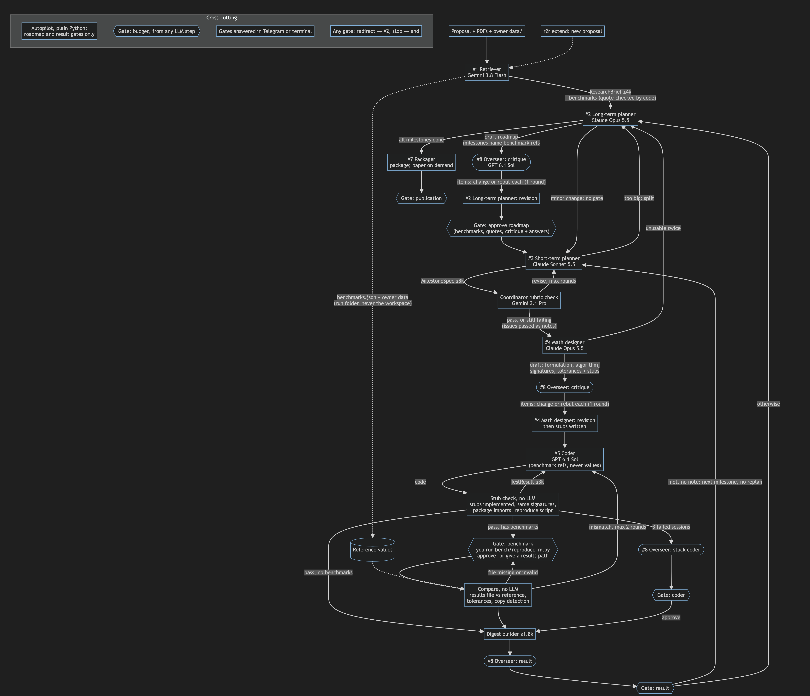

# Architecture



The diagram's source is [network_layout.mmd](network_layout.mmd). Default models are set in
[config/models.yaml](../config/models.yaml), which takes precedence over the model names drawn in
the diagram.

## Roles

| Role | Writes | Notes |
|---|---|---|
| Retriever | `ResearchBrief`, paper cards, benchmarks | Code checks each benchmark against its source quote |
| Long-term planner | `Roadmap` | Rewritten as results come in; asked to split oversized milestones |
| Short-term planner | `MilestoneSpec` | One milestone at a time |
| Coordinator | `CoordinatorVerdict` | Rubric check; its issues reach the designer as notes |
| Math designer | `MathSpec`, stubs | Formulation, algorithm, signatures, tolerances |
| Coder | Code, through tools | Runs in the sandbox; sees benchmark names, never values |
| Overseer | Critiques, briefings, flags | Advises only: it never routes, approves or spends |
| Writer / packager | Paper sections, wheel | Numbers only from inputs, citations only from `refs.bib` |

## Parts that use no LLM

| Module | Job |
|---|---|
| `graph/routing.py` | Decides what runs next |
| `harness/stubcheck.py` | Checks stubs are implemented, signatures are unchanged, and the package imports |
| `harness/benchmarks.py`, `harness/compare.py` | Quote-check benchmarks and compare results with them |
| `harness/autopilot.py` | Optional rules for routine gates; coder, benchmark and budget gates always go to you |
| `harness/sandbox.py` | Docker isolation and resource limits |
| `digest/builder.py` | Builds the result summary; an LLM only adds a note when a criterion fails |

## Rules the code follows

- Everything passed between agents or graph nodes is a Pydantic contract from `contracts/`.
- Heavy data lives in the blob store, and contracts carry references to it.
- Every LLM call goes through `llm/gateway.py`, which handles budget checks, the ledger, retries
  and caching.
- Model IDs appear only in `config/models.yaml`, and limits only in `config/budgets.yaml`.
- Reference values stay in the run folder and never enter the coder's workspace.
- Proposal and paper text is untrusted: it's wrapped as data, and instructions inside it are not
  followed.

## A run on disk

```
runs/<run_id>/
├── workspace/          # the code the agents build
├── workspace.git/      # its git history, kept outside the workspace
├── data/               # your reference data and benchmarks.json
├── blobs/              # papers, logs, large text
├── vectors/            # Chroma index for this run
├── checkpoints.sqlite  # LangGraph state, used by `holdout resume`
└── ledger.sqlite       # every LLM call and its cost
```

`runs/` is git-ignored. It's a symlink to `runs.nosync/`, so iCloud won't sync SQLite files
mid-write if the project sits in a synced folder.
