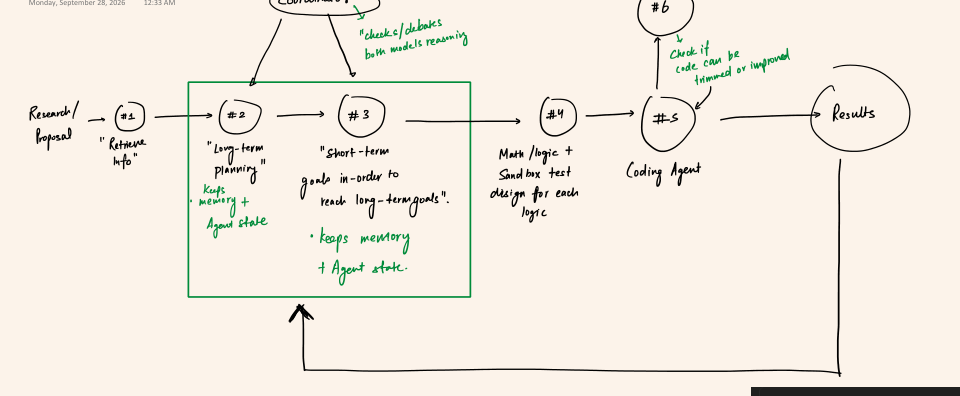
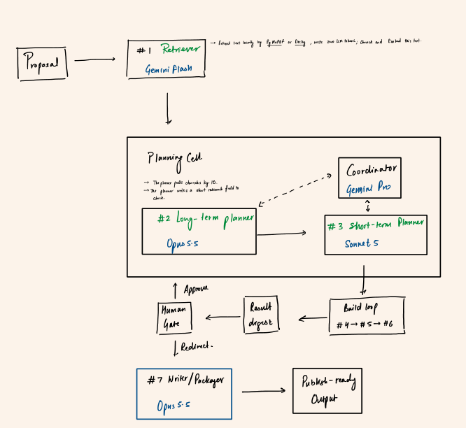
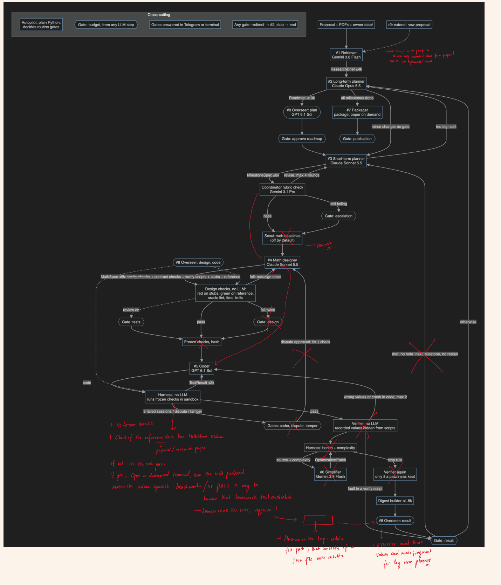
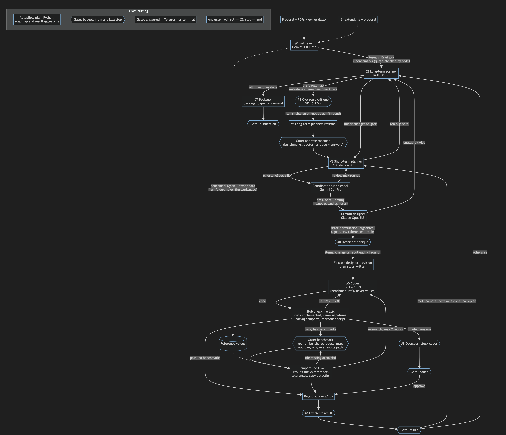

# Design history

Holdout's network changed a lot because real runs kept showing where it failed or wasted money. The
reasons for each change are in [DECISIONS.md](DECISIONS.md).

## 1. First sketch

The first idea was simple: retrieve information, plan long and short term, design the logic, code
it, and feed results back to the planners. A coordinator would debate the planners' reasoning.

## 2. Planning cell and build loop

The next version assigned a model to each role, grouped the planners into a planning cell, and
added a human gate after each build loop. Agents would pass contracts rather than chat.

## 3. The checks grow, then get cut

As runs exposed problems, the network gained frozen tests, verify scripts, a web scout and a code
simplifier. Each one answered a real failure, but together they became expensive: in one study the
math designer alone took 43% of the spend ($12.48 of $28.90) and caused most of the stalls.

The red pen marks the redesign (decision D93): remove the frozen checks and the scout, and take
benchmark values from the proposal. A person runs the produced code and supplies a results file,
which plain code compares with the benchmarks. The overseer then reads those values and advises
the long-term planner.

## 4. Current network

Later, the overseer also gained one round of critique on each roadmap and design (D94), and the
author must change or rebut each point.
